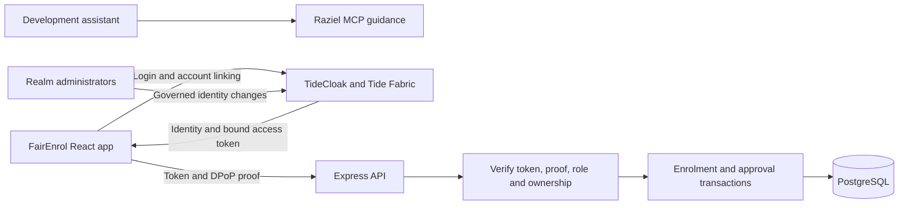

# FairEnrol: plan for a working TideCloak app

Prepared on 22 October 2026. Scope: extend the existing FairEnrol React/Vite app. This document records the original implementation plan and baseline assessment.

Implementation has since started. See [the implementation status](IMPLEMENTATION_STATUS.md) for current code, verification evidence and the live token-signing issue; the assessment below records the original baseline.

## Recommended outcome

Keep the current interface and add a Node/Express API with PostgreSQL. Use TideCloak for real user identity, verified roles, sender-constrained API access, and governance of identity/configuration changes. Implement FairEnrol's enrolment and exception rules in server transactions.

The first release should demonstrate this complete journey: a student logs in, joins a full course's queue, a registrar requests an exception, two separate eligible approvers approve it, and every browser sees the persisted result and its public explanation. A registrar's direct override request must fail at the API.

Tide's MCP, Raziel, supplies implementation guidance during development. It is not the runtime identity server or the application database. Its locally installed server was actually queried for this plan.

## What exists today

| Area | Verified state | Consequence |
| --- | --- | --- |
| Frontend | React 19, Vite, `@tidecloak/react` installed | Extend the existing app rather than replace its framework. |
| Provider | `src/main.jsx` requests `/tidecloak.json` | `public/tidecloak.json` is absent; real login cannot be claimed as working. |
| Identity | Login/logout and role-reading hooks exist | Role claims are displayed, but the selected demo role controls the screens and actions. |
| Business data | `src/App.jsx` uses `useReducer` seeded from `src/seed.json` | Enrolments, approvals, panel membership, and audit entries exist only in one browser session. |
| Authority | The viewer selects a student, registrar, or approver | A real user is not bound to the identity making the change. |
| Approvals | Two simulated votes immediately apply a reducer action | The workflow has no server enforcement or persistent approval evidence. |
| API/database | None in this repository | There is no shared source of truth or concurrency control. |
| Local URL | `vite.config.js` fixes port **5137** | Correct README references to 5173 and register the actual callback/origin. |
| Build | `npm.cmd run build` passed | The frontend bundles; this does not verify authentication or authorization. |
| Tide doctor | Read-only check: 1 pass, 1 warning, 2 failures | Missing adapter and DPoP relay; DPoP is not configured. No API was available to inspect. |
| MCP | Local `@tideorg/mcp` **1.9.33** connected via stdio | MCP playbooks can already be consulted without changing the user's global MCP configuration. |

## Architecture



Development: React at `http://localhost:5137`, API at `http://localhost:3001`, with Vite proxying `/api`. Production: serve the UI and `/api` behind one HTTPS origin. Verify DPoP against the public request URL, including when a reverse proxy forwards requests internally.

Proposed additions:

```text
src/api/client.js                authenticated API calls using the provider's secureFetch
src/hooks/useCurrentUser.js      verified current-user response and UI permissions
src/components/                 extract existing dashboards as they are connected to APIs
server/index.js                 Express entrypoint and routing
server/auth/                    Tide token, DPoP, role and ownership checks
server/services/enrolment.js    capacity, FIFO queue and promotion transactions
server/services/exceptions.js   request, approval, denial and application transactions
server/routes/                  courses, current user, requests and public audit views
db/migrations/                  PostgreSQL schema and constraints
scripts/                        reproducible setup and verification helpers
tests/                          API integration and browser journey tests
.env.example                    variable names only
compose.yaml                    local app data services; chosen TideCloak setup if self-hosted
```

These paths are proposed, not existing implementation. Keep `@tideorg/mcp` as development tooling; it need not run in the deployed app.

## Milestones and completion evidence

### 1. Establish a reproducible Tide environment

1. Choose local Docker or a managed TideCloak instance before realm bootstrap. Local Docker is the planning recommendation for a laptop demo. A public demonstration requires a deliberate hosting/realm decision; do not assume a local realm can simply be migrated later.
2. Before creating or licensing a realm, obtain the user's licence email and explicit acceptance of [Tide's terms](https://tide.org/legal). These are future setup inputs, not assumed approvals.
3. Use the MCP's hosting and realm-bootstrap playbooks. Establish a compatible container/SDK set, record the versions, and retain the lockfile.
4. Create the `fairenrol` realm and SPA client. For local development register the `http://localhost:5137` origin and the required redirect, logout and silent-SSO URLs. Use exact URLs where supported.
5. Enable licensed Tide-mode IGA, complete account linking, approve the required initial changes, and export the Tide adapter with its embedded public verification key (`jwk`). Confirm the chosen runtime exposes the documented API before scripting it.
6. Store only the SPA-safe adapter in `public/tidecloak.json`. Put administrative credentials in a gitignored environment file. Add `.env` to `.gitignore` before creating it; the current ignore file does not include it.

**Exit evidence:** the realm/client and test identities exist, the adapter is valid, and startup works from documented steps. Human account-linking and licence inputs remain explicit setup dependencies.

### 2. Complete login and protect a minimal API

1. Keep `TideCloakContextProvider`; put strict DPoP options inside its `config` object. The current React provider does not take a separate `useDPoP` prop.
2. Use `tide_dpop_asset` to select the canonical relay from the installed SDK/pack and copy it without changing its bytes. Add Vite development/preview middleware and production-host routing for `/tide_dpop/iss/<hex>/aud/<hex>/tide_dpop_auth.html`, with the required response headers. `silent-check-sso.html` serves a separate purpose and does not replace this relay.
3. Implement API authentication using `@tidecloak/verify` plus the MCP's tested DPoP verifier, or the playbook's complete `jose` implementation. Require the adapter's embedded verification key and the expected issuer/client binding; reject expired or invalid tokens. `verifyTideCloakToken` alone does not verify DPoP.
4. Verify the proof signature, token/key binding, method, public URL, access-token hash, freshness and replay identifier. Do not allow a bound token to bypass proof checks by presenting it as Bearer. A scaled API needs a shared replay store; a single process cache is only suitable for the explicitly single-instance local demo.
5. Add `GET /api/me`. Identify users by verified issuer plus `sub`, not their display name or a browser-supplied student ID. Map that identity to a student/staff record on the server.
6. Call APIs through the provider hook's `secureFetch` using absolute URLs. Respect SDK initialization before issuing requests.

**Exit evidence:** real login, callback, refresh and logout succeed; `/api/me` returns the correct identity; unauthenticated, forged, expired and proof-replayed API calls fail.

### 3. Persist courses and enforce FIFO enrolment

Use PostgreSQL tables for `users`, `courses`, `enrolments`, `waitlist_entries`, `panels`, `panel_members`, `exception_requests`, `request_approvals`, `audit_events`, and mutation idempotency records.

Key constraints: unique `(issuer, subject)` identity; unique course/student enrolment and waitlist entries; unique request/approver vote; one application event per exception request. Use server-generated IDs and times. Allocate queue order while holding the course's transaction lock so ordering matches the committed admission sequence.

Implement enrolment, self-withdrawal and FIFO promotion in transactions that lock the course and relevant request rows. The server decides whether the student gets a seat or joins the queue. A normal capacity increase must promote waiting students before admitting newcomers. A decrease below current enrolment must be rejected or handled through a separately approved policy; it must not silently evict anyone.

Seed data becomes a development database fixture. React state becomes a view of API results, not the authority for mutations. Start with refetching after changes and bounded polling across browsers; realtime subscriptions can wait.

**Exit evidence:** a refresh and API restart preserve data; two independent browsers share the same queue; simultaneous last-seat requests cannot oversubscribe the course.

### 4. Enforce roles and two-of-three exception approval

Proposed roles and responsibilities:

| Actor | Allowed actions |
| --- | --- |
| Student | View available courses and their own enrolments/queue positions; enrol or withdraw as themselves. |
| Registrar | Manage permitted capacity changes and propose exceptions; cannot directly reorder queues, remove students, force-enrol, or edit the panel. |
| Approver | Propose exceptions and approve/deny eligible pending requests as their own identity. |
| Realm administrator | Govern Tide identity, role and client configuration; this does not automatically confer an application exception vote. |

Store a versioned snapshot of the three eligible panel members with each request. Require two distinct authenticated approvers, no self-approval, and a unique vote per request. Bind approvals to immutable action details: request ID, action, target, reason, panel/policy version and relevant course version. Editing the proposal invalidates existing approvals. Reject stale preconditions instead of executing a materially different action.

The second valid approval applies the action and writes its audit event in one database transaction. Retries and concurrent final approvals must not apply it twice. Denied or cancelled requests cannot later execute. A replacement panel member cannot vote themselves onto the panel; validate the proposed composition and invalidate/reissue pending requests when panel authority changes.

Keep the app's panel membership distinct from Tide's coarse `approver` eligibility role. A panel-change request may select an already eligible member; granting a new identity that Tide role is a separate governed identity change. Recheck active eligibility server-side, with an explicit revocation policy rather than relying indefinitely on an old access token.

Remove the role/person impersonation controls from working mode. If a separate demo mode is retained, label it and isolate it from the real API.

**Exit evidence:** changing the frontend or making direct API calls cannot impersonate another student, invent approver votes, or bypass the registrar's restrictions. Two different linked accounts complete the approved exception once.

### 5. Add genuine Tide governance with an accurate product claim

There are two different approval systems:

| System | What it governs | What it does not automatically govern |
| --- | --- | --- |
| Tide IGA in licensed Tide mode | Supported identity, role, client and policy/configuration changes | Arbitrary enrolment rows in FairEnrol's database |
| FairEnrol API and database | Course capacity rules, queues, exception votes and panel composition | Protection against an operator who can replace the API or directly rewrite its database |

Use Tide's existing admin console for identity governance first. Do not build a second IGA console unless the product needs one. The MCP's scenario matcher suggested `iga-admin-governance`, but that is a supporting identity workflow, not a ready-made course-approval implementation.

Configure and verify the realm's actual multi-admin threshold. Do not assume it equals FairEnrol's two-of-three rule; the MCP reports an admin-count-derived IGA threshold. Use the current change-request API and confirm actual commitment. The playbook recommends `/iga/change-requests/{id}/approve`; older documents/SDK helpers still mention different approval lanes and legacy endpoints. Check against the chosen build rather than mixing them.

For the first working release, describe FairEnrol's exception flow as **server-enforced two-person approval using Tide-authenticated identities**. The existing promise that no single person can move the line needs this explicit operating boundary.

If the intended requirement is independent cryptographic evidence for each course exception, add a separate research milestone: evaluate policy-governed signing of a canonical request payload, verification at execution/read time, replay protection and panel-policy changes. A role-threshold policy alone does not establish no-self-approval or the semantics of a course action. The MCP says custom Forseti deployment is experimental and performed by the Tide team. Treat this as an external dependency, not a guaranteed self-service step or a prerequisite for basic enrolment to function. Signing evidence also does not itself stop a database owner from deleting or editing rows.

**Exit evidence:** a real identity/configuration change follows the configured IGA ceremony; course changes follow the separate tested application rules; UI and README claims match that evidence.

### 6. Verify, package and demonstrate

Add a redacted public exception/audit view. Keep student IDs and sensitive accommodation evidence out of that response. The current example mentions accessibility; publish an appropriate summary while restricting detailed evidence to authorized reviewers. Append-only permissions and a hash chain can strengthen the audit design, but do not claim they make an operator-controlled database immutable.

Run `tide_doctor` in check mode after auth changes, then against the running app to verify the relay response. Use API integration tests for authorization, state transitions and concurrency; use browser tests for the actual identity journeys. A static doctor result or successful build is insufficient by itself.

Minimum acceptance suite:

1. Login, callback, refresh, logout and denied access after session expiry.
2. Missing/forged/expired/wrong-issuer/wrong-client token rejected; bound token without proof, wrong proof key/method/URL and replay rejected.
3. A student cannot act for another identity or call registrar/approver endpoints.
4. Two concurrent enrolments for the last seat produce one enrolment and one queued student; duplicates/retries do not create extra entries.
5. Withdrawal and capacity increase promote the correct queue member transactionally.
6. Self-vote, duplicate vote, ineligible member, stale proposal, denied request and stale panel cannot execute an action.
7. Two distinct valid approvers apply the same exception once, including concurrent final votes/retries.
8. Direct registrar force-enrol, queue reorder and panel-edit calls are denied.
9. Public endpoints do not return private reasons, evidence, tokens or student identity details.
10. Data survives browser refresh and service restart; a database backup restores successfully; real login and DPoP still work behind the intended deployment proxy.

Document exact setup, migration, seed, start, test and reset steps. Provide separate test accounts for student, registrar and three approvers. The demonstration should show a failed unauthorized API action as well as the successful approval journey. Deploy only after selecting the target environment and completing these checks.

**Exit evidence:** a fresh setup can reproduce the complete journey with separate identities, persistent state and meaningful rejection cases.

## Proposed API contract

| Endpoint | Authorization and behavior |
| --- | --- |
| `GET /api/me` | Verified identity, mapped application identity and capabilities. |
| `GET /api/courses` | Authenticated course availability; no full student roster by default. |
| `POST /api/courses/:id/enrolments` | Student self-enrolment; server chooses seat or FIFO waitlist. |
| `DELETE /api/courses/:id/enrolments/me` | Self-withdrawal and transactional FIFO promotion. |
| `PATCH /api/courses/:id/capacity` | Registrar; validated limit, promotion and audit. |
| `POST /api/exception-requests` | Registrar or eligible approver; immutable proposal and server-recorded requester. |
| `GET /api/exception-requests` | Authorized reviewers; students receive only permitted/redacted views. |
| `POST /api/exception-requests/:id/approvals` | Current eligible approver; server derives voter and applies only at threshold. |
| `POST /api/exception-requests/:id/denial` | Eligible reviewer, pending state only; records reason. |
| `GET /api/public/exceptions` | Redacted public explanations and outcomes. |

There is no general-purpose direct force-enrol or queue-reorder endpoint. Ordinary commands and exception execution use the same central transactional service so alternate routes cannot bypass the rules.

## How to use Tide MCP during implementation

The installed package exposes a standard stdio MCP server at `node_modules/@tideorg/mcp/mcp-server/dist/index.js`. It can be launched with Node by an MCP client. Installing the npm package alone does not register a server with every AI client. For this assessment a temporary MCP SDK client connected locally, listed its tools, queried guidance and closed; global client configuration was not modified.

Use these calls at the relevant milestones:

| MCP call | Purpose |
| --- | --- |
| `tide_hosting` | Resolve local versus managed hosting before realm creation. |
| `tide_playbook` with `bootstrap-realm-from-template` and `initialize-admin-and-link-account` | Establish the licensed realm and linked identities. |
| `tide_canon` with `framework-matrix`, section `React (Vite/CRA) Implementation` | Use React provider and Express patterns, adapting Next.js-specific instructions. |
| `tide_dpop_asset` | Obtain the canonical relay asset and verification instructions. |
| `tide_playbook` with `verify-jwt-server-side` | Implement full server-side token and proof enforcement. |
| `tide_playbook` with `setup-iga-admin-panel` | Understand IGA lifecycle and current endpoints, even if using the built-in console. |
| `tide_doctor` | Obtain checks; use check-only during review and verify the running host later. |

Already consulted for this plan: scenario/playbook selection, React framework guidance, hosting, IGA scenario and role matrix, IGA setup, server verification, custom-contract scope, DPoP asset instructions and doctor instructions. The read-only doctor command was executed. Its findings were recorded above; no fixes or realm operations were run because the requested deliverable is the implementation plan.

## Sources and evidence boundaries

- Repository evidence: `src/App.jsx`, `src/main.jsx`, `src/seed.json`, `vite.config.js`, `package.json`, `.gitignore`, `README.md` and `public/` contents.
- Installed Tide MCP: `@tideorg/mcp` 1.9.33, queried on 22 October 2026. Local package guidance is versioned evidence, not proof of a deployment's behavior.
- [Tide MCP overview](https://docs.tide.org/ai-agent-pack): purpose and supported implementation workflows.
- [Official React tutorial](https://docs.tide.org/Languages/React/tidecloak-react-tutorial): realm, client and adapter prerequisites.
- [Official React how-to guide](https://docs.tide.org/Languages/React/tidecloak-react-how-to-guide): React, DPoP relay and hosting requirements. Asset examples can vary across documentation revisions; prefer the installed MCP/SDK's verified relay and test the actual served response.
- Runtime evidence collected: successful frontend production build and the static, check-only Tide doctor result. Real authentication, realm governance, application API enforcement, concurrency and deployment behavior remain unverified until implemented and exercised.

Suggested execution order: **environment → login and protected API → persistent FIFO enrolment → independent approvals → identity governance → verification and deployment**. Implement and verify each milestone before expanding the next one.
