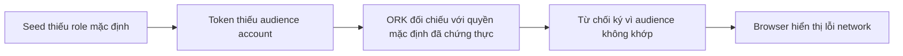
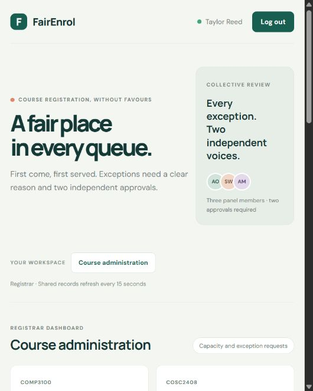

# Chẩn đoán lỗi đăng nhập TideCloak của FairEnrol

Kiểm tra ngày 22/10/2026, Docker local. **Đã sửa và xác nhận tài khoản registrar đăng nhập Tide thật, tải API bảo vệ và reload thành công sau khi khôi phục transport bình thường.** Phê duyệt CR quản trị và kiểm thử nhiều người dùng là phần còn lại riêng biệt.

## Nguyên nhân đã xác nhận

Script seed ban đầu chỉ import role ứng dụng và bỏ sót `default-roles-fairenrol`. Keycloak không tự bổ sung role mặc định khi import có `realmRoles` tường minh. ORK tính composite mặc định từ dữ liệu đã chứng thực toàn realm, nên audience không khớp:

```text
Route: /Authentication/Key/v1/PreSign
HTTP: 400
Code: TIDE-ORK-ATTESTATION-INVALID
Detail: token claim 'aud' does not match attested value
 token=["fairenrol-client","realm-management"]
 attested=["account","fairenrol-client","realm-management"] [aud]
```

Lỗi xảy ra tại `TidecloakSessionStartTokenSign:1`. TideCloak không đạt quorum ký token, trả `temporarily_unavailable`/502; SDK biểu hiện thành `Failed to fetch` hoặc `Network request failed`. Tide MCP troubleshooting T-19 giải thích cơ chế lỗi server bị che thành fetch/CORS. Đây là lỗi bootstrap/data local đã đo được, không phải bằng chứng Tide outage toàn hệ thống.



## Bản sửa và bằng chứng thật

- `scripts/tide-setup.mjs` import cả `template.defaultRole.name` và role ứng dụng; kiểm tra mapping trước khi cấp quyền quản trị đầu tiên. Với realm đã MultiAdmin, phát hiện thiếu sẽ dừng và yêu cầu sửa qua governance, không tự bypass.
- Bản sao H2 xác nhận 25 seed user thiếu mapping. Thử bổ sung trên bản sao cho preview audience đúng. Xác minh **97/97 + 92/92** chữ ký attestation vẫn hợp lệ.
- API gán role trên realm thật tạo CR pending. MultiAdmin cần ceremony của người quản trị, nhưng chính tài khoản đó chưa đăng nhập được vì mapping thiếu.
- Người dùng cho phép rõ ràng “Cho phép sửa một dòng local”. Đã sao lưu H2 mới, bổ sung đúng một mapping của linked registrar, xác minh 189 chữ ký trước khi đưa staging trở lại. Không áp dụng ngoại lệ này cho 24 tài khoản khác.
- Sau sửa, người dùng hoàn tất Tide login và app hiện **Taylor Reed / Registrar**, tải được course data qua API thật. Observer sau sửa ghi 14 phản hồi Sign HTTP 200; một PreSign 408 riêng lẻ không làm mất quorum.
- Đã gỡ observer và proxy/trust override khỏi container đang chạy, khởi động TideCloak bằng Compose bình thường và reload trình duyệt. Dashboard có xác thực và dữ liệu vẫn tải lại thành công.



Chi tiết phạm vi, backup và CR: [TIDECLOAK_DEFAULT_ROLE_REPAIR.md](TIDECLOAK_DEFAULT_ROLE_REPAIR.md).

## Những gì đã kiểm tra và giới hạn

| Kiểm tra                     | Kết quả                                                                             |
| ---------------------------- | ----------------------------------------------------------------------------------- |
| API và PostgreSQL            | Healthy, dữ liệu có xác thực tải thành công                                         |
| Relay DPoP                   | Byte-exact với SDK, đúng issuer/client, CSP và Allow-CSP-From                       |
| CORS preflight               | Chấp nhận origin `http://localhost:5137`, DPoP và credentials                       |
| Phiên bản                    | Container/JS 0.14.41, React wrapper 0.14.33; đồng bộ phiên bản chưa đủ sửa lỗi data |
| Đồng hồ                      | Host, container và home ORK khớp trong vài giây                                     |
| Link và licence              | Link có thật, account enabled, licence chưa hết hạn                                 |
| IGA                          | Bật Tide mode; hiện có đúng 1 CR sửa còn PENDING, 0/1                               |
| Chữ ký attestation           | 189/189 hợp lệ; không đồng nghĩa mọi claim token đều khớp                           |
| Build và API suite           | Build qua, 15/15 test qua                                                           |
| Verify và Doctor sau cleanup | Verify qua; Doctor 15 PASS, 1 WARN về CR pending, 0 FAIL                            |

Chữ ký được kiểm tra trên bản sao H2 read-only bằng public key Ed25519 của adapter và Jackson CBOR 2.21.7 lấy từ container, đối chiếu `UnitColumnMapping`. Preview TVE không có chữ ký token; chưa từng dùng preview làm access token. Bằng chứng runtime là việc API thật chấp nhận token và proof của trình duyệt.

## Các dấu vết cũ đã tách khỏi nguyên nhân chính

Lượt SSO cũ trả `TIDE-ORK-INTERNAL-UNEXPECTED`, `Index out of range. (Parameter 'index')`, HTTP 500. Bằng chứng session đã hết hạn trước một lượt console, nhưng còn hạn lúc fresh-login HTTP 400; vì vậy không quy nguyên nhân fresh-login cho expiry hoặc một policy parser chưa được chứng minh.

Observer đầu tiên chỉ nhận field viết thường và bỏ sót `Code`/`Detail` PascalCase. Sau sửa bộ đọc và kiểm tra redaction, lượt fresh-login mới thu được lỗi audience chính xác ở trên. Observer không lưu request body, token, authentication header hay success body. Private CA chỉ được trust trong container chẩn đoán; upstream TLS vẫn được xác minh. Cấu hình tạm đã được tháo khỏi dịch vụ đang chạy.

## Phần còn lại

CR `1623e3b2-14c0-4d0b-9aec-29a0f425d1e7` chưa được Tide phê duyệt. Đã thử hai console tích hợp và panel SDK tạm trên origin FairEnrol: `/approve` trả `needs-approval`, nhưng cửa sổ enclave không xuất hiện trong browser panel, không trả model đã ký. Chưa đủ bằng chứng kết luận nguyên nhân popup/handshake. Không tự ghi authorization hoặc commit CR bằng backend thay người dùng.

24 tài khoản seed khác vẫn cần sửa mapping qua governance, rồi liên kết bằng tài khoản Tide riêng và chạy acceptance nhiều người. Logout/fresh-login sau cùng chưa được kiểm tra riêng; reload và tải API sau restart đã qua.

Dữ liệu chẩn đoán, H2 backup và code panel tạm nằm trong `.local/diagnostics/`, bị Git ignore và chứa dữ liệu local cần giữ riêng. Không gửi log/database cho Tide hay bên thứ ba. Không xoá realm, tắt DPoP/IGA hoặc thay signer.
